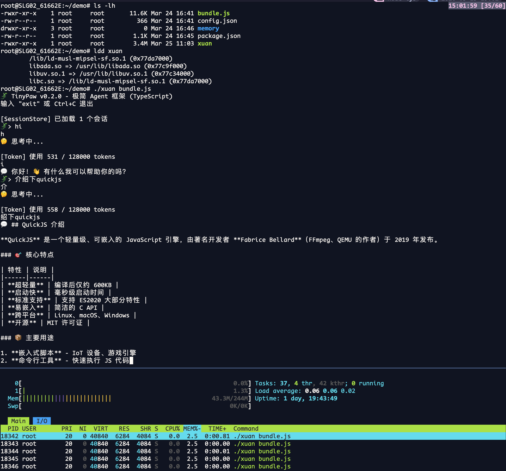

# 玄 (xuan)

> 深层机制 / 不可见运行逻辑 — 轻量级 JavaScript 运行时

[English](./README.md) | **中文**

xuan (读作"玄") 是一个轻量级 JavaScript 运行时，设计用于物联网场景。基于
[QuickJS](https://bellard.org/quickjs/) 和 [tjs(txiki.js)](https://github.com/saghul/txiki.js/)
构建，继承其轻量级特性：

- **广泛的 Node.js API 兼容性** — 可直接运行现有 npm 包
- **内置 IoT 模块** — MQTT、Serial Port (GPIO/I2C/SPI 待添加)
- **FFI (Foreign Function Interface)** — 直接调用 C 库函数，复用现有 C 库
- **低内存占用** — 显著小于 Node.js
- **紧凑的二进制** — 约 6-7MB（不含 SQLite 更小）

专为嵌入式和边缘设备设计。

---

## 特性

- **⚡ 闪电般快速启动** — 毫秒级冷启动，适合资源受限的 IoT 设备
- **📦 极小体积** — 二进制大小约 6-7MB（不含 SQLite 更小）
- **💾 低内存使用** — 相比 Node.js 显著降低内存占用
- **🌐 Node.js 兼容** — 广泛的 Node.js API 兼容性，直接运行现有 npm 包
- **🔌 IoT 就绪内置模块** — 原生 MQTT、Serial Port (GPIO/I2C/SPI 待添加)
- **🛠️ 嵌入式就绪** — 支持 MIPS、ARM、RISC-V、x86 等多种架构
- **📦 编译发布** — 一键编译 JS 为独立可执行文件，无需运行时依赖
- **🧩 ESM + CommonJS** — 支持 `import`/`export`、动态 `import()`、顶层 `await` 与 `require()`

---

## 应用场景

- 🏠 **智能家居** — 照明控制、传感器数据采集
- 🏭 **工业物联网** — 设备监控、边缘计算
- 🌾 **农业物联网** — 环境监测、自动灌溉
- 📡 **边缘网关** — 协议转换、数据预处理
- 🤖 **边缘 AI Agent** — 智能小车小龙虾，基于 LLM 的本地 agent

---

## 快速开始

### 克隆与构建

```bash
# 克隆项目
git clone https://github.com/topelinux/xuan.git
cd xuan

# 初始化子模块
git submodule update --init --recursive --force

# 安装 JS 构建依赖 (esbuild、polyfills 等)
npm install

# 构建
make
```

> `make` 内部通过 `npx esbuild` 生成 bundles，因此请先执行 `npm install`。

> 对依赖库（`libwebsockets`、`quickjs`、`libuv`、`mimalloc`）的本地改动以 patch
> 形式存放在 `patches/` 下，由 `make` 自动应用。请勿直接修改 `deps/` 子模块内的文件。

### Hello World

```javascript
// main.js
console.log('Hello from xuan!');

// IoT 示例: 读取 GPIO (待添加)
// const gpio = require('gpio');
// const sensor = gpio.open(17);
// sensor.read((value) => {
//     console.log('Sensor value:', value);
// });
```

### 运行

```bash
./build/xuan run main.js
```

### 编译发布 (推荐用于 IoT 场景)

将 JavaScript 代码编译打包成独立的可执行文件，无需额外依赖，直接发布二进制：

```bash
# 编译 JS 为独立可执行文件 (生成 myapp)
./build/xuan compile main.js myapp

# 直接运行编译后的二进制
./myapp
```

**优势**：

- 无需 Node.js 环境，真正的独立部署
- 体积更小、启动更快
- 适合资源受限的 IoT 设备分发

### 包管理

xuan 内置了 npm 兼容的包管理器，支持安装 npm 包：

```bash
# 初始化项目
./build/xuan npm init

# 安装包
./build/xuan npm install <package>

# 卸载包
./build/xuan npm uninstall <package>
```

xuan 会自动从 npm registry 下载并安装包到本地 `node_modules` 目录，支持直接
require 加载。

### 推荐: 使用 esbuild 打包 (IoT 场景)

对于 IoT 等资源受限场景，推荐使用 esbuild 将应用打包成单个文件并 minify，可显著
减小体积和启动时间：

需要先安装 esbuild：

```bash
npm install -g esbuild
```

然后使用 esbuild 打包：

```bash
# 打包并 minify
esbuild entry.js --bundle --minify --outfile=bundle.js
```

然后用 xuan 运行打包后的文件：

```bash
./build/xuan run bundle.js
```

> 💡 **xuan compile vs esbuild**: `xuan compile` 将 JS 嵌入运行时生成独立二进制，
> 适合直接分发；esbuild 打包减小体积，但仍需 xuan 运行时运行。

### 示例: 边缘 AI Agent (玄灵 XuanLing)

xuan 可作为边缘 AI Agent 运行时，在资源受限设备上运行轻量级 LLM 应用：

```bash
# 进入示例目录
cd xuan_apps/xuanling

# 设置 llm 供应商
cp config.example.json config.json

# 启动对话 (交互式)
./build/xuan run xuan_apps/xuanling/bin/xuanling.js chat \
  --config xuan_apps/xuanling/config.json \
  --workspace /tmp/xuanling-workspace
```



**项目特点**：

- 玄灵 (XuanLing) 是极简的对话式 LLM Agent 框架，支持 tool calling
- 可在资源受限设备（包括 MIPS 开发板）上运行
- 支持本地部署的 LLM (如 Ollama)
- 适合边缘智能场景

---

## 架构

```
┌─────────────────────────────────────┐
│           xuan Runtime              │
├─────────────────────────────────────┤
│  Node.js Compatible API Layer       │
├─────────────────────────────────────┤
│  IoT Native Modules (GPIO/I2C/SPI to be added)  │
├─────────────────────────────────────┤
│  QuickJS Engine                     │
├─────────────────────────────────────┤
│  Embedded System (Linux/RTOS)       │
└─────────────────────────────────────┘
```

### 技术栈

- **核心引擎**: [QuickJS](https://bellard.org/quickjs/) — 快速且轻量的 JavaScript 引擎
- **运行时基础**: 基于 [tjs (txiki.js)](https://github.com/saghul/txiki.js/) — 最初为 Web 场景设计的 QuickJS 运行时
- **设计灵感**: 借鉴 AWS Lambda Runtime Thin (LRT) 的理念 — 为无服务器环境优化
- **我们的定位**: tjs 面向 Web，LRT 面向无服务器，**xuan 专为物联网和嵌入式系统设计**
- **硬件抽象**: 统一的 IoT 设备访问接口
- **模块系统**: CommonJS + ES Modules 支持

---

## 内置 IoT 模块

xuan 内置必需的 IoT 模块，无需额外安装：

| 模块 | 描述 |
|--------|-------------|
| **mqtt** | MQTT 客户端，用于发布/订阅消息 |
| **serialport** | 串口通信 |
| **ffi** | 调用 C 库函数，复用现有 C 库 |
| **gpio** | GPIO 引脚控制 (待添加) |
| **i2c** | I2C 总线通信 (待添加) |
| **spi** | SPI 总线通信 (待添加) |

---

## 模块系统与 async

xuan 同时支持 **ES Modules** 与 **CommonJS**，以及贯穿全局的 async/await：

- `import` / `export`、动态 `import()`、`import.meta`
- **顶层 `await`**
- 通过 import attributes 导入 JSON
- 与 CommonJS 互操作：`require()` / `module.exports`

模块解析规则：`.mjs` 一律按 ESM，`.cjs` 一律按 CommonJS；`.js` 看最近的
`package.json` 的 `"type"`（没有则嗅探文件内容）。

```javascript
// app.mjs
import { readFile } from 'node:fs/promises';

async function loadConfig() {
    const raw = await readFile('./config.json', 'utf8');
    return JSON.parse(raw);
}

// 顶层 await
const config = await loadConfig();

const os = await import('node:os');       // 动态导入
console.log(import.meta.dirname);         // 脚本所在目录
console.log(config.id, typeof os.totalmem);
```

```javascript
// JSON 导入
import data from './data.json' with { type: 'json' };
console.log(data.widget.debug);

// 在 ESM 里使用 CommonJS
const os = require('node:os');
```

> 💡 内置模块使用 `tjs:` 前缀（如 `import FFI from 'tjs:ffi'`），这是沿用自
> txiki.js 的命名约定。

---

## API 示例

### MQTT (内置)

```javascript
const mqtt = require('mqtt');
const client = mqtt.connect('mqtt://broker.emqx.io');

client.on('message', (topic, message) => {
    console.log('recv:', topic, message.toString());
});

client.on('error', (err) => {
    console.error('error:', err);
});

client.on('connect', () => {
    console.log('connect');
    client.subscribe('iot/device/001/#', { qos: 1 }, (err) => {
        if (err) {
            console.log('subscribe error', err);
        } else {
            console.log('subscribe success');
        }
    });
    setInterval(() => {
        client.publish('iot/device/001/status', 'online', { qos: 1 });
    }, 5000);
});
```

### 串口 (内置)

```javascript
const SerialPort = require('serialport');
const port = new SerialPort('/dev/ttyUSB0', { baudRate: 9600 });

port.write('AT\n');
port.on('data', (data) => {
    console.log('Received:', data.toString());
});
```

### FFI (调用 C 库)

FFI 模块允许直接调用 C 库函数，方便复用现有 C 库：

```javascript
import FFI from 'tjs:ffi';

// 加载 C 库
const libc = new FFI.Lib(FFI.Lib.LIBC_NAME);

// 调用 C 函数: atoi
const atoi = new FFI.CFunction(
    libc.symbol('atoi'),
    FFI.types.sint,
    [FFI.types.string]
);
console.log(atoi.call('123'));  // 输出: 123

// 调用 C 函数: getenv
const getenv = new FFI.CFunction(
    libc.symbol('getenv'),
    FFI.types.string,
    [FFI.types.string]
);
console.log(getenv.call('HOME'));  // 输出: /home/xxx

// 调用 C 函数: time
const time = new FFI.CFunction(
    libc.symbol('time'),
    FFI.types.sint64,
    [FFI.types.pointer]
);
console.log('Current timestamp:', time.call(BigInt(0)));

// 调用自定义 C 函数
const mylib = new FFI.Lib('./libmylib.so');
const myfunc = new FFI.CFunction(
    mylib.symbol('my_function'),
    FFI.types.sint,
    [FFI.types.sint, FFI.types.sint]
);
console.log(myfunc.call(1, 2));
```

### GPIO 控制 (待添加)

```javascript
// const gpio = require('gpio');

// // 输出模式
// const led = gpio.open(18, { mode: 'out' });
// led.write(1);  // LED亮
// led.write(0);  // LED灭

// // 输入模式
// const button = gpio.open(23, { mode: 'in', pull: 'up' });
// const state = button.read();
```

### I2C 通信 (待添加)

```javascript
// const i2c = require('i2c');
// const device = i2c.open(1, 0x68);  // 总线1, 地址0x68

// device.write([0x00, 0x10]);
// const data = device.read(4);
```

---

## 性能

### 冷启动 Benchmark（MacBook Air M1）

| 运行时 | 版本 | 冷启动均值 | 冷启动中位数 | P95 | 可执行文件大小 |
|---------|------|------------|--------------|-----|----------------|
| **xuan** | dev | 5.37ms | 5.35ms | 6.07ms | 6.2MB |
| bun | 1.3.11 | 8.82ms | 8.68ms | 9.70ms | 58MB |
| Node.js | v24.13.0 | 20.29ms | 20.18ms | 21.31ms | 112MB |

*测试日期: 2026-03-27*
*测试环境: macOS 13.7.3, Apple M1, Darwin 22.6.0*
*方法: 三个运行时均使用 `-e "0"`，每个运行时 220 次，随机交错执行，统计进程从启动到退出的 wall-clock 时间。*

> 注: 本轮仅测试冷启动时间与可执行文件体积，未包含驻留内存测试。

### 启动调优环境变量

建议使用 `XUAN_*` 前缀：

- `XUAN_LIGHTWEIGHT_POLYFILLS=0|1`
  控制是否启用轻量 polyfills 启动路径。默认会在 `-e/--eval/eval/-h/--help/-v/--version`
  使用轻量路径。非轻量路径会在 `lite` 基础上再加载 `compat`。
- `XUAN_HEAVY_WEB_POLYFILLS=0|1`
  控制是否加载重型 Web polyfills（如 `CompressionStream` / `WebSocketStream` 相关），
  加载时机为 `lite + compat` 之后。
- `XUAN_STARTUP_PROFILE=1`
  打印启动分段耗时（stderr，按耗时排序）。

> 💡 **注意**: 二进制大小可以通过排除可选组件（如 SQLite）进一步减小。这使得 xuan
> 对于资源受限的嵌入式设备更具成本效益。

---

## 从源码构建

### 构建要求

- **macOS**: Xcode 或 Command Line Tools
- **Linux**: clang-15 或更高版本
- **MIPS 交叉编译**: 需要安装 zig

### 构建步骤

```bash
git clone https://github.com/topelinux/xuan.git
cd xuan

# 初始化子模块
git submodule update --init --recursive --force

# Linux 需要设置 clang-15
export CC=clang-15
export CXX=clang++-15

# 安装 JS 构建依赖 (esbuild、polyfills 等)
npm install

# 构建
make

# 运行测试
make test
```

### JS Bundle 构建流程

xuan 将 JavaScript 模块编译为 C 文件 (`src/bundles/c/**/*.c`) 后嵌入二进制。

这些 C bundles 是构建产物，不应提交到 Git（仓库已忽略 `src/bundles/c/`）。

**本机构建**:
```bash
make
# 会自动生成/更新 bundles 后再编译
```

**修改 JS 源文件后**:
```bash
make js
make
```

**Cross build**:
```bash
# 脚本会先在 host 上自动执行 make js，再进行交叉编译
BUILD_WITH_MIMALLOC=ON TJS_WAMR_SIMD=ON ./scripts/build-aarch64.sh
```

### 交叉编译

```bash
# ARM64
make TARGET=arm64

# RISC-V
make TARGET=riscv64

# AArch64 (GNU/Linux, 动态链接，解释器通常为 /lib/ld-linux-aarch64.so.1)
# 需要先安装 zig: brew install zig (macOS) 或 apt install zig (Linux)
# 无 sysroot/无预置 libffi 时会自动从 deps_lib/libffi-3.5.2 构建动态 libffi (libffi.so*)
# 默认关闭 WAMR SIMD 以避免跨平台构建时在线拉取 simde（可用 TJS_WAMR_SIMD=ON 打开）
# 最简（无 sysroot）:
./scripts/build-aarch64.sh
# 若你有 sysroot:
TJS_AARCH64_SYSROOT=/path/to/aarch64-sysroot ./scripts/build-aarch64.sh

# MIPS (动态链接)
# 需要先安装 zig: brew install zig (macOS) 或 apt install zig (Linux)
TJS_MIPS_SYSROOT=/path/to/target-mipsel_24kc_musl TJS_LINK_MODE=dynamic TJS_USE_DEPS_LIBUV_SHARED=ON ./scripts/build-mips-static.sh
```

---

## 致谢

xuan 基于以下优秀项目构建：

- **[tjs (txiki.js)](https://github.com/saghul/txiki.js/)** — 由 Saúl Ibarra Corretgé 开发的 QuickJS 运行时，提供了优秀的 Node.js 兼容性和轻量级设计。本项目 fork 自该项目，并延续 MIT 许可证。
- **[QuickJS](https://bellard.org/quickjs/)** — 由 Fabrice Bellard 开发的轻量级 JavaScript 引擎

---

## 贡献

欢迎贡献！请随时提交 issue、fork 仓库并发送 pull request。

1. Fork 项目
2. 创建功能分支 (`git checkout -b feature/AmazingFeature`)
3. 提交更改 (`git commit -m 'Add some AmazingFeature'`)
4. 推送到分支 (`git push origin feature/AmazingFeature`)
5. 打开 Pull Request

---

## 许可证

MIT License — 详见 [LICENSE](LICENSE)。

---

<div align="center">

**玄** — JavaScript for Every Device

Made with ⚡ by the xuan Team

</div>
